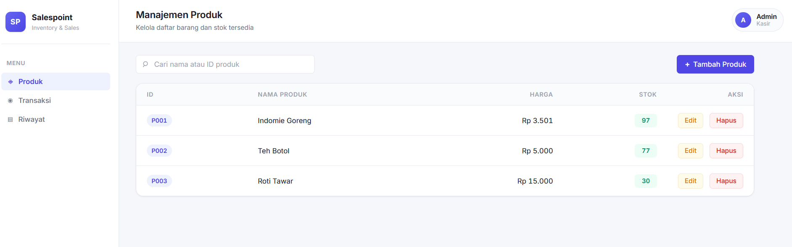
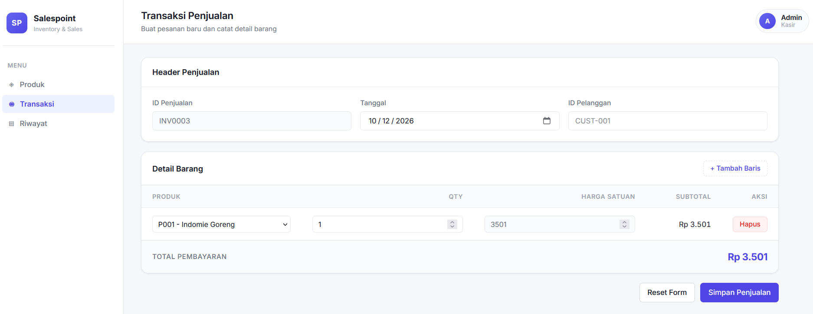
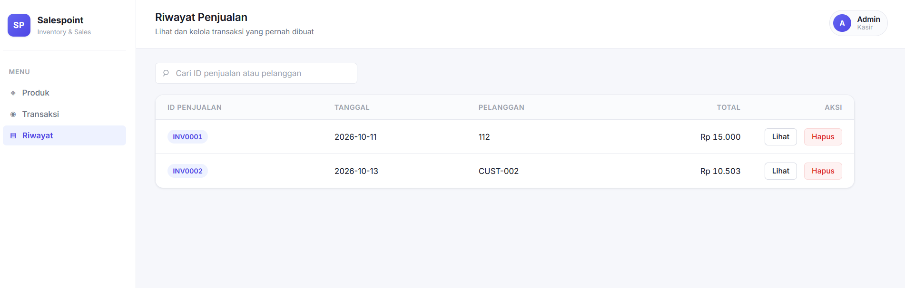
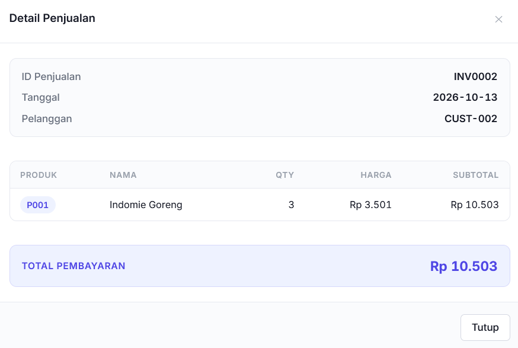

# Sistem Penjualan

Aplikasi web buat catat penjualan barang. Bisa kelola produk, bikin transaksi, terus lihat riwayatnya. Semua jalan di browser, data disimpan di localStorage.


## Fitur

- CRUD produk, bisa tambah, edit, hapus
- Bikin transaksi penjualan dengan header dan detail barang
- Stok otomatis berkurang setiap transaksi disimpan
- Riwayat penjualan lengkap dengan detail
- Hapus transaksi, stoknya balik lagi ke semula
- Pencarian produk dan riwayat
- Tampilan responsif, di HP juga masih enak dilihat

## Tampilan

Halaman Produk



Transaksi Penjualan



Riwayat Penjualan



Detail Penjualan



## Cara Jalanin

Nggak perlu install apa-apa. Clone, terus buka.

```bash
git clone https://github.com/username/sistem-penjualan-WCS.git
cd sistem-penjualan-WCS
